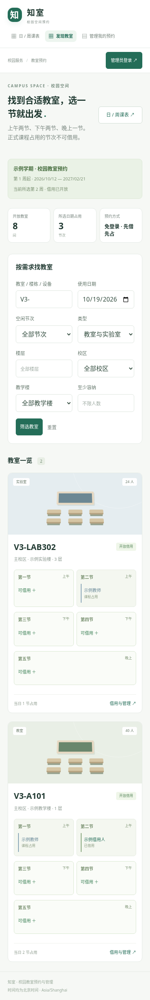
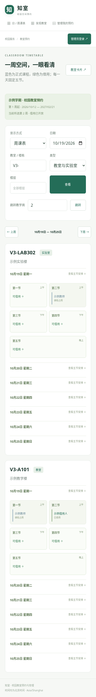

# 知室 · 校园教室预约与管理

中文、手机适配的学校教室预约系统。Python 3.12 + Django 5.2 LTS + MySQL 8，支持 Docker 部署到腾讯云轻量应用服务器。


## 已实现的流程

| 使用者 | 使用方式 | 权限 |
| --- | --- | --- |
| 普通用户（学生、教师） | 无需账号；填写姓名、学号/工号、学院/班级、联系方式及本次预约密码 | 提交即占用；可验证后编辑/取消自己的这一笔预约 |
| 管理员 | 学校创建的管理账号 | 查看全部详情，编辑、退回、撤销预约，导入课表、管理教室 |

- **Excel 一键导入正式课程课表**：支持中文表头、课程周次/单双周/星期、排除日期、节次或课程精确时间。单双周只属于正式课程，普通借用不分单双周。
- **不必预建教室**：导入自动创建缺失教室，可附带校区、楼栋、楼层、类型与容量；未知资料显示待补充。管理员也可在网页手动新建/编辑教室或实验室。
- **课程优先占用**：正式课程只要与某个借用节次重叠，该节就不可借用；显示、筛选和最终提交采用相同的精确重叠规则。冲突导入整批回滚，包含自动新建教室。
- **五个固定借用节次**：上午第一/二节、下午第三/四节、晚上第五节；普通用户只能选择节次，不能自填钟点。默认实际时间为 08:00–09:40、10:00–11:40、14:00–15:40、16:00–17:40、19:00–21:00，仅管理员可调整。
- **管理员设置学期**：名称、起止日期、起始周数、开放/暂停借用。学期外不能借用；已有课表或未来预约的设置变更会先检查影响。
- **手机与电脑分别呈现**：电脑使用完整日/周表；手机使用按教室、日期展开的五节卡片，触控控件放大。支持楼层、类型、人数、日期、空闲节次筛选。
- 所有人可见借用人姓名；学号/工号、联系方式、用途仅管理员及通过该笔验证的本人可见。每笔独立修改密码采用 PBKDF2 哈希；本人可编辑、取消，管理员可编辑、退回、撤销，全部检查冲突并留痕。
- 普通用户免账号、先提交先占用，不审批。普通借用每笔一节，最多提前 14 天；开始前不足 30 分钟须联系管理员修改/取消。
- **预约信息上限一个月（30 天）**。生产模板在线 21 天 + 备份至多 7 天，总时长低于 30 天；编辑不会延长保留期。正式教学配置独立保存，不随短期预约记录清理而丢失未来课程。


 

## 本地试用（无 MySQL）

SQLite 仅供单人本地开发；多用户部署必须使用 MySQL/PostgreSQL。

```bash
python3.12 -m venv .venv
. .venv/bin/activate
pip install -r requirements.txt
export DEBUG=true
python manage.py migrate
python manage.py collectstatic --noinput
python manage.py seed_demo
python manage.py createsuperuser
python manage.py runserver 127.0.0.1:8000
```

在另一终端启动 `DEBUG=true .venv/bin/python manage.py run_retention`，该进程同时定期清理和同步学期课表。示例仅有教室，不创建默认账号。`createsuperuser` 生成管理员；普通师生无需账号。首次由管理员在“学期与节次”设置学期，然后从“教学占用”下载 Excel 模板并一键导入；不必先手动创建教室。从“教室管理”可补齐自动创建教室的资料，从“预约管理”进入记录详情编辑/退回。

## 上传腾讯云部署

1. 在 GitHub 点击 **Code → Download ZIP**，解压后上传整个目录到服务器独立目录，例如 `/opt/classroom-booking`。
2. 按 [腾讯云部署手册](docs/TENCENT_DEPLOY.md) 配置 `.env`、独立 MySQL 数据库与账号、子域名 DNS、HTTPS 和新的 Nginx 虚拟主机。
3. 构建应用镜像、执行数据库迁移、创建管理员，启动 `web` 与 `retention` 两个服务。
4. 完成 [上线验收清单](docs/ACCEPTANCE.md) 后供学校使用。

**不要覆盖主站文件、Nginx 主配置或主站数据库；不要在已有站点服务器上重装/替换整套面板或反向代理。** 本项目的 Compose 只发布本机 `18080` 端口，不抢占主站 80/443，不公开数据库端口。

## 验证

```bash
export DEBUG=true
python manage.py collectstatic --noinput
python manage.py check
python manage.py test -v 2
```

SQLite 会明确跳过行锁并发测试。要执行全部测试，请安装 `requirements-mysql.txt`，并设置 `DB_ENGINE=mysql`、`DB_HOST`、`DB_PORT`、`DB_NAME`、`DB_USER`、`DB_PASSWORD` 指向**专用测试数据库服务器**。Django 会创建/删除 `test_<DB_NAME>`，测试账号需对此测试库有权限。不要向生产账号增加全局权限来运行测试。GitHub Actions 使用独立 MySQL 8.4 测试服务。

## 目录

```text
booking/             业务、权限、事务服务、测试和管理命令
config/              Django 配置与路由
templates/ static/   中文界面，无外部字体/CDN依赖
deploy/              健康检查与 Nginx 示例
docs/                部署、保留策略、验收与开发说明
compose.yaml         使用已有 MySQL 的生产服务
compose.local-db.yaml 可选的独立 MySQL 容器
```

参考用户提供的《教室预约与管理网站_开源项目调研整合报告.pdf》中的业务与部署设计，未复制报告所列项目的代码；见 [参考与许可证](THIRD_PARTY.md)。本仓库采用 GPL-3.0-or-later。学校可自行部署、修改；对外分发需遵守许可证。

当前不含短信/邮件通知、校园单点登录、自动学籍验证或自动排课。课表文件需按模板整理，支持 CSV/XLSX，不支持旧版 .xls 或任意教务系统格式自动识别。身份信息为自填；学号/工号及预约密码只验证该笔记录的控制权，不证明真实学籍。

## 将 GitHub 仓库改为私有

本次 GitHub 设置 API 连接返回 403（CONNECT 被拒绝），无法代改仓库可见性。你可以用仓库所有者/管理员账号打开 [仓库设置](https://github.com/805113044/6/settings)，在 General 底部 Danger Zone → Change repository visibility → Change visibility → Make private，按提示确认 `805113044/6`。完成后仓库会标记 Private；仍可登录后 Download ZIP。详细说明见 [仓库私有化](docs/GITHUB_PRIVATE.md)。
