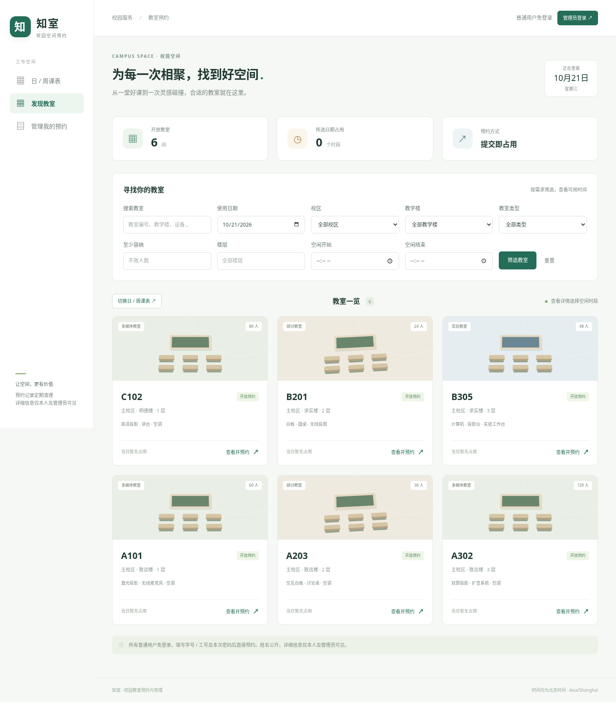
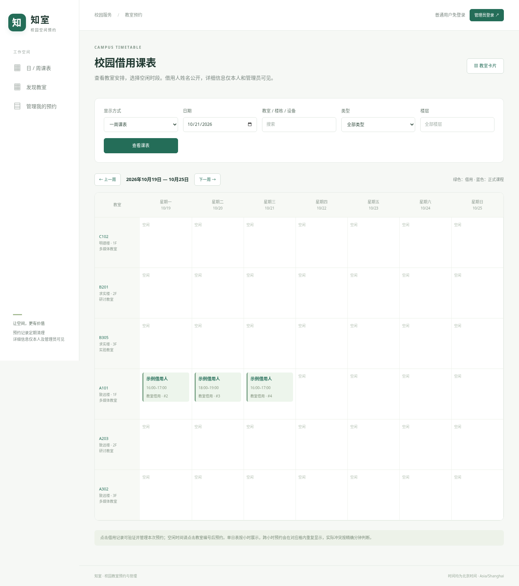

# 知室 · 校园教室预约与管理

中文、手机适配的学校教室预约系统。Python 3.12 + Django 5.2 LTS + MySQL 8，支持 Docker 部署到腾讯云轻量应用服务器。



## 已实现的流程

| 使用者 | 使用方式 | 权限 |
| --- | --- | --- |
| 普通用户（学生、教师） | 无需账号；填写姓名、学号/工号、学院/班级、联系方式及本次预约密码 | 提交即占用；可验证后编辑/取消自己的这一笔预约 |
| 管理员 | 学校创建的管理账号 | 查看全部详情，编辑、退回、撤销预约，导入课表、管理教室 |

- 公开显示借用人姓名，其他预约信息仅管理员和该笔验证通过的本人可见；不公开学号、学院、联系方式或普通借用用途。
- 教室卡片、周课表和单日时段表三种视图，按楼层、实验室/教室类型、人数、日期、精确空闲时段筛选。
- 普通用户先提交先占用，无需审批。数据库事务锁定教室；编辑换房、改时间、被退回后重提都重新校验冲突。
- **每笔预约的学号/工号 + 独立修改密码**用于验证，密码使用 Django PBKDF2 安全哈希，15 分钟授权仅限这一笔；修改身份信息/密码立即撤销旧会话。每笔密码可以不同，不是校园账号密码。
- 管理员退回立即释放时段并记录原因；本人修改后重新提交，需重新抢占。管理员编辑、导入、撤销都记录操作日志。
- CSV / Excel XLSX 导入日期课表或学期单双周规则；包含第一教学周、周次范围、星期、单双周、任课教师、排除日期。先预览、确认写入；冲突整批回滚，重复导入跳过。
- 学期规则作为教学配置保存，后台滚动展开可预约窗口；查询远期周也显示计划课程。单次调课/取消作为例外，不被后台同步重建。
- 默认 07:00–22:00，提前 30 天，单次最多 4 小时；普通用户开始前不足 30 分钟须联系管理员修改/取消。
- 预约记录最多保留 60 天；生产在线 45 天 + 备份至多 14 天，详见 [数据保留说明](docs/DATA_RETENTION.md)。



## 本地试用（无 MySQL）

SQLite 仅供单人本地开发；多用户部署必须使用 MySQL/PostgreSQL。

```bash
python3.12 -m venv .venv
. .venv/bin/activate
pip install -r requirements.txt
export DEBUG=true
python manage.py migrate
python manage.py collectstatic --noinput
python manage.py seed_demo
python manage.py createsuperuser
python manage.py runserver 127.0.0.1:8000
```

在另一终端启动 `DEBUG=true .venv/bin/python manage.py run_retention`，该进程同时定期清理和同步学期课表。示例仅有教室，不创建默认账号。`createsuperuser` 生成管理员；普通师生无需账号。管理员从导航“预约管理”进入记录详情编辑/退回，从“教学占用”下载导入模板。

## 上传腾讯云部署

1. 在 GitHub 点击 **Code → Download ZIP**，解压后上传整个目录到服务器独立目录，例如 `/opt/classroom-booking`。
2. 按 [腾讯云部署手册](docs/TENCENT_DEPLOY.md) 配置 `.env`、独立 MySQL 数据库与账号、子域名 DNS、HTTPS 和新的 Nginx 虚拟主机。
3. 构建应用镜像、执行数据库迁移、创建管理员，启动 `web` 与 `retention` 两个服务。
4. 完成 [上线验收清单](docs/ACCEPTANCE.md) 后供学校使用。

**不要覆盖主站文件、Nginx 主配置或主站数据库；不要在已有站点服务器上重装/替换整套面板或反向代理。** 本项目的 Compose 只发布本机 `18080` 端口，不抢占主站 80/443，不公开数据库端口。

## 验证

```bash
export DEBUG=true
python manage.py collectstatic --noinput
python manage.py check
python manage.py test -v 2
```

SQLite 会明确跳过行锁并发测试。要执行全部测试，请安装 `requirements-mysql.txt`，并设置 `DB_ENGINE=mysql`、`DB_HOST`、`DB_PORT`、`DB_NAME`、`DB_USER`、`DB_PASSWORD` 指向**专用测试数据库服务器**。Django 会创建/删除 `test_<DB_NAME>`，测试账号需对此测试库有权限。不要向生产账号增加全局权限来运行测试。GitHub Actions 使用独立 MySQL 8.4 测试服务。

## 目录

```text
booking/             业务、权限、事务服务、测试和管理命令
config/              Django 配置与路由
templates/ static/   中文界面，无外部字体/CDN依赖
deploy/              健康检查与 Nginx 示例
docs/                部署、保留策略、验收与开发说明
compose.yaml         使用已有 MySQL 的生产服务
compose.local-db.yaml 可选的独立 MySQL 容器
```

参考用户提供的《教室预约与管理网站_开源项目调研整合报告.pdf》中的业务与部署设计，未复制报告所列项目的代码；见 [参考与许可证](THIRD_PARTY.md)。本仓库采用 GPL-3.0-or-later。学校可自行部署、修改；对外分发需遵守许可证。

当前不含短信/邮件通知、校园单点登录、自动学籍验证或自动排课。课表文件需按模板整理，支持 CSV/XLSX，不支持旧版 .xls 或任意教务系统格式自动识别。身份信息为自填；学号/工号及预约密码只验证该笔记录的控制权，不证明真实学籍。
